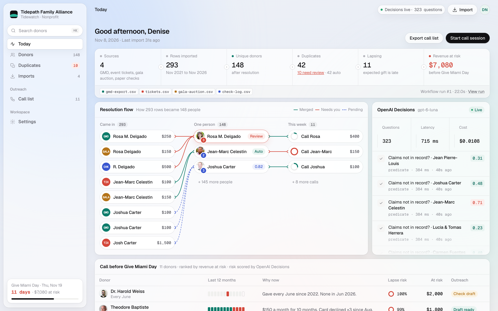
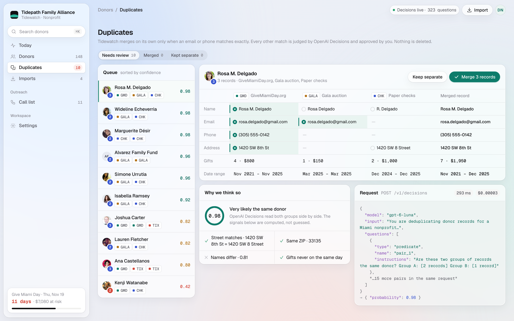
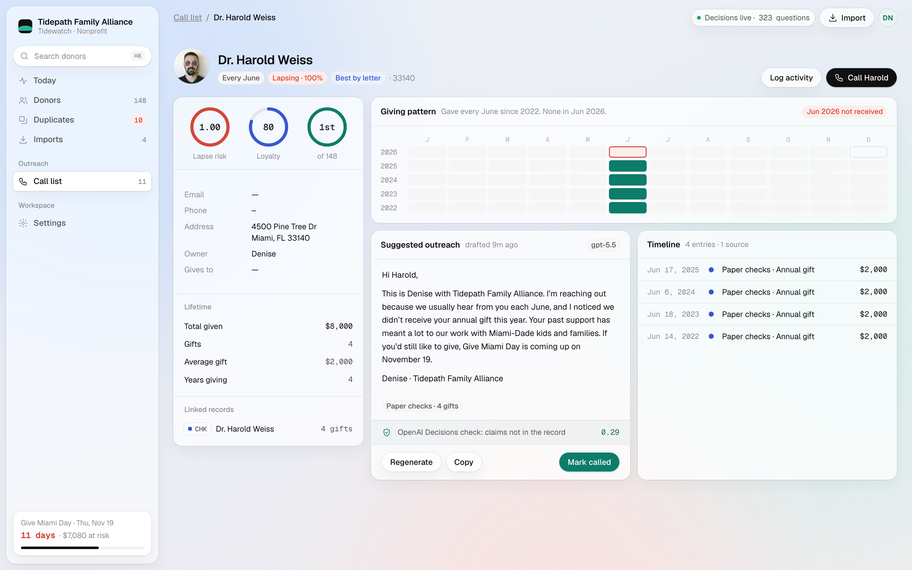
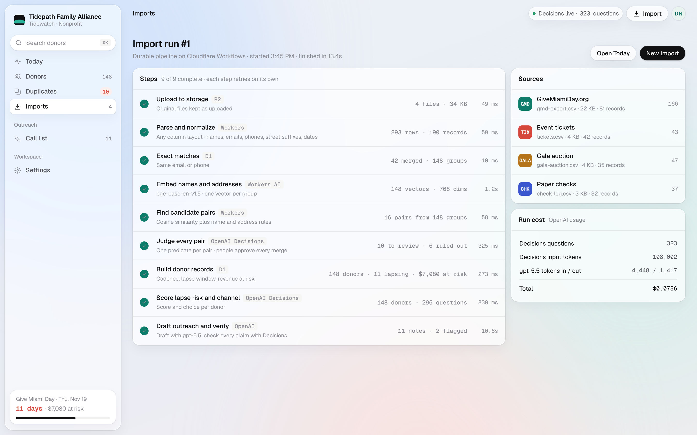
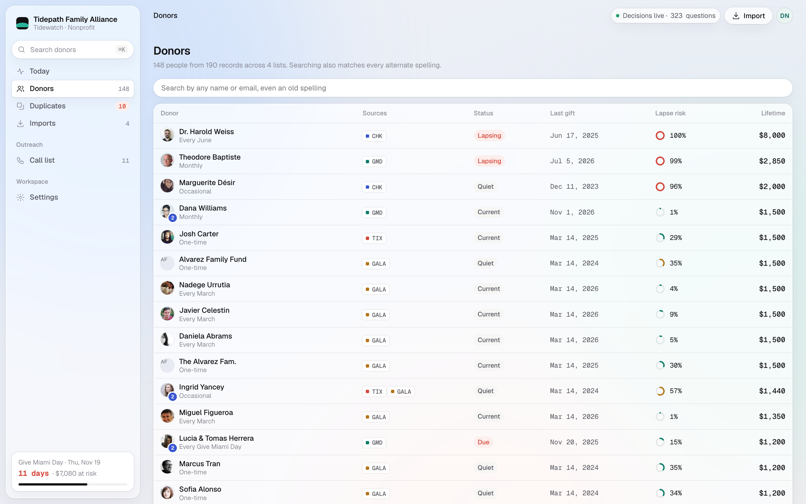

# Tidewatch

**Turn messy donor exports into one clean list of people, and know who's about to stop giving while there's still time to call.**

Drop in every donor list you have. Tidewatch resolves every human to one record, ranks everyone, and tells you who to call before the money stops.

Built for the [Give Miami Day](https://www.givemiamiday.org) community hackathon by The Miami Foundation, challenge 2: *duplicate donor records, and donors who quietly stop giving.*

> **Live: https://tidewatch.micahberkley.com** · Import, entity resolution, lapse scoring, drafting, merge review and the call list all run end to end on Cloudflare against real OpenAI Decisions and gpt-5.5 calls. A full sample import takes about 20 seconds. All data in `public/samples/` is fictional.



## The problem

Give Miami Day sends thousands of donations to small nonprofits as CSV exports. Fiscally sponsored projects have nothing but that CSV. Gifts also arrive through event tickets, gala auctions and paper checks, and each keeps its own list.

So one donor ends up in the database as "Rosa Delgado", "Rosa M. Delgado" and "R. Delgado", gets the year-end letter three times, and the totals are wrong. Worse, nothing says when someone stops giving. A donor who gave every December skipped last year and nobody called. A monthly donor's card expires and the gifts just stop.

## What it does

1. **Drop your lists.** GiveMiamiDay.org export, ticketing, gala, typed-in checks.
2. **Find the people.** Duplicates are found and shown side by side. A person approves each merge. Nothing is deleted: every source record and gift is kept, and each merge is logged on the donor's ledger.
3. **See who's slipping.** Donors whose expected gift is late, ranked by dollars at risk.
4. **Make the call.** A note drafted only from that donor's real record, with the facts it used shown next to it.

## Screens

| Duplicates | Donor |
| --- | --- |
|  |  |
| **Import run** | **Donors** |
|  |  |

## How the AI is used

Every judgment call goes through the [OpenAI Decisions API](https://developers.openai.com/api/docs/guides/decisions), which returns a probability for a typed question instead of free text:

| Question | Type | Used for |
| --- | --- | --- |
| Are these records the same person? | predicate | merge candidates, up to 400 per request |
| How likely is this donor to lapse? | score | the call list |
| Does this note say anything not in the record? | predicate | a check before any note is shown |

Drafted notes use a chat model and are limited to the facts passed in. The UI shows each question and its probability, so the model's work is visible rather than implied.

## How it works

An import is a Cloudflare Workflow with durable steps that each retry on their own:

1. **Upload to storage** (R2). Originals kept as uploaded.
2. **Parse and normalize** (Workers). Any CSV column layout; names, emails, phones, street suffixes, dates.
3. **Exact matches** (D1). Same email or phone merges automatically.
4. **Embed** (Workers AI, `bge-base-en-v1.5`) and **find candidate pairs** by surname plus initial, street or embedding similarity.
5. **Judge every pair** (OpenAI Decisions predicate). Every AI-suggested merge goes to a person for approval.
6. **Build donor records** (D1). Cadence (monthly, every Give Miami Day, every June…), the lapse window and revenue at risk are computed in code.
7. **Score lapse risk and best channel** (OpenAI Decisions score and choice, one of each per donor).
8. **Draft outreach** (gpt-5.5, from the donor's record only) and **fact-check each note** (Decisions predicate: claims not in the record?).

Merging a pair in the UI rebuilds that donor, re-scores them live with Decisions, and redrafts their note.

## Stack

- Cloudflare **Workers** (Hono API + static assets via the Vite plugin), **D1**, **R2**, **Workflows**, **Workers AI**
- **OpenAI Decisions** (`gpt-6-luna`) for every judgment, **gpt-5.5** (Responses API) for notes
- Vanilla TypeScript front end, Vitest for the pure logic

## Run locally

```bash
npm install
cp .dev.vars.example .dev.vars        # then put your OpenAI key in it
npx wrangler d1 migrations apply tidewatch --local
npx vite --port 8790                  # Workers AI calls need a Cloudflare login or CLOUDFLARE_API_TOKEN
```

Open `http://localhost:8790`, click **Use sample data**, and watch the import run.

```bash
npx vitest run --config vitest.config.ts --maxWorkers=2
```

Regenerate the sample exports with `python3 scripts/gen_sample.py`.

## Deploy

```bash
npx wrangler d1 create tidewatch            # put the id in wrangler.jsonc
npx wrangler r2 bucket create tidewatch-files
npx wrangler d1 migrations apply tidewatch --remote
npm run build && npx wrangler deploy
npx wrangler secret put OPENAI_API_KEY
```

## Data

All names, gifts and organizations in the mockups are made up. Tidepath Family Alliance is a fictional nonprofit from the hackathon brief.

## License

[MIT](LICENSE)
